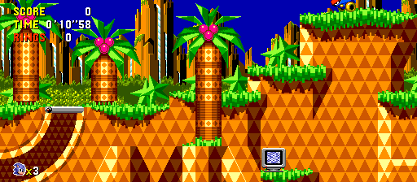
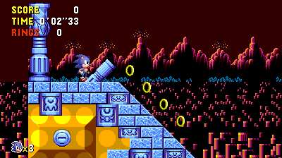
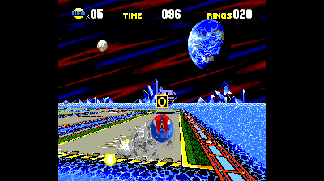
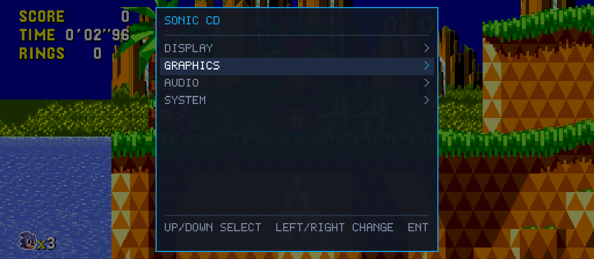

# Sonic CD Recompiled

Play the original **Sonic CD** on Windows and Linux, with native recompilation,
recomp-ui settings, adaptive widescreen and faster resident file loading.

[Download 0.0.4](https://github.com/mstan/SonicCDRecomp/releases/tag/v0.0.4) ·
[Getting started](#getting-started) · [Build from source](docs/BUILDING.md) ·
[Report a bug](https://github.com/mstan/SonicCDRecomp/issues/new/choose)

<table>
  <tr>
    <td width="50%"><br><strong>Adaptive widescreen</strong><br>Real stage scenery follows the window's aspect ratio.</td>
    <td width="50%"><br><strong>The original stages</strong><br>Present, Past, Good Future and Bad Future.</td>
  </tr>
  <tr>
    <td width="50%"><br><strong>Special stages</strong><br>The original projection and HUD are preserved.</td>
    <td width="50%"><br><strong>recomp-ui</strong><br>Change display, graphics and audio settings in game.</td>
  </tr>
</table>

Screenshots are from the native Windows build. Special stages and cinematic
scenes retain their original presentation; widescreen expansion applies to
supported normal stages.

## Getting started

You supply **your own Sonic CD US disc image and US Sega CD BIOS**. Neither is
included. This release supports one qualified disc/BIOS revision; see
[supported inputs](docs/INPUTS.md) for identifiers and disc conversion details.

**Windows 10/11 x64**

1. Download and extract `SonicCD-0.0.4-windows-x64.zip` into a writable folder.
2. Run `SonicCD.cmd` and choose your BIOS and disc image when prompted.
3. Press **Enter** at the original title/menu screens to start.

A prepared `.sgcd` image needs no Python installation. A raw `.cue`/`.bin` set
requires Python 3 for the included converter; tracks remain beside their CUE.

**Linux x86_64**

1. Download `SonicCD-0.0.3-linux-x86_64.AppImage`.
2. Make it executable and run it:

   ```sh
   chmod +x SonicCD-0.0.3-linux-x86_64.AppImage
   ./SonicCD-0.0.3-linux-x86_64.AppImage
   ```

3. Choose your BIOS and disc. Python 3 and either Zenity or KDialog provide
   first-run input selection; paths can also be supplied from the terminal.

The initial Linux build targets **x86_64 with glibc 2.39 or newer** (Ubuntu
24.04 baseline). See [Linux setup](docs/USAGE.md#linux) for dependencies, FUSE
alternatives and command-line input selection.

The game opens in a normal window with audio and **adaptive / Fit to screen**
enabled. Press **F1** or **Esc** for recomp-ui. Settings and game saves persist
under `userdata` beside the extracted Windows package or Linux AppImage.
Updates preserve an existing save; keep that directory when moving the game.

## Controls

| Action | Keyboard | Controller |
|---|---|---|
| Move | Arrow keys | D-pad / left stick |
| A / B / C | Z / X / C | X / A / B |
| Start | Enter | Start |
| Settings | F1 / Esc | Back |
| Pause emulation | P | Settings menu |

## What's included

- Original Main/Sub 68000 and Z80 programs execute as generated native code.
- Original stages, time travel, bosses, special stages, ending and credits.
- Original FM/PSG, PCM and CD audio, and persistent Sega CD backup RAM.
- Adaptive stage widescreen, original-aspect and fixed 16:9 options.
- Window, filtering and volume controls through recomp-ui.

This is an early release. [Validation and known limits](docs/VALIDATION.md)
distinguishes tested outcomes from unverified coverage. It does not include
the separate S3K campaign adaptation, Shadow mod, netplay or save-state/rewind UI.

## Source and credits

This game repository pins the reusable
[segagenesisrecomp Sega CD backend](https://github.com/mstan/segagenesisrecomp/tree/feature/segacd-backend),
[M68K core](https://github.com/mstan/m68k-recomp-core),
[Z80 core](https://github.com/mstan/z80-recomp-core), and
[recomp-ui](https://github.com/mstan/recomp-ui). The shared backend remains on
its feature branch; this release does not merge it into the engine's main branch.
The [build guide](docs/BUILDING.md) explains the owned-input generation pipeline.

Project code uses [PolyForm Noncommercial 1.0.0](LICENSE).
[Third-party notices](THIRD-PARTY-LICENSES.md) and component license texts ship
with the downloads. These licenses do not grant rights to Sonic CD or its BIOS.
Sonic CD and its characters belong to SEGA. This is an unofficial fan project.
